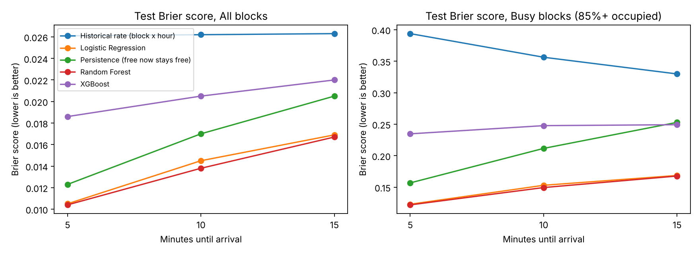
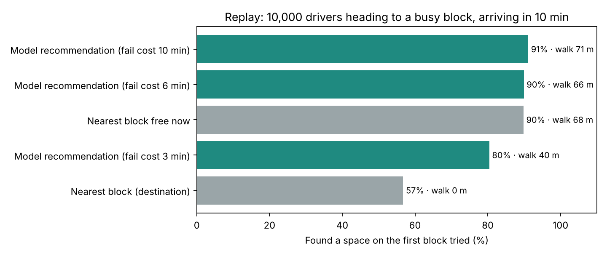

# Will I Find a Spot? Predicting Parking Availability on Arrival in Downtown San Francisco

DATA 245 · Machine Learning · Alaa Tarek

This project predicts the **probability that at least one general metered space is free on a block when a driver arrives 5, 10 or 15 minutes from now**, and uses that probability to recommend which block to drive to. The study area is San Francisco's Financial District / South Beach, the densest metered area in the city.

It is the code for my [Intermediate Status Report](docs/Intermediate_Status_Report.pdf), in two parts:

| Part | What it does | Data | Status |
| --- | --- | --- | --- |
| **SF supply layer** | Cleans the meter inventory, classifies who may use each space, counts general spaces per block and builds 200 m / 400 m choice sets | SFMTA Parking Meters (DataSF) | Code + tests; run the download on your computer |
| **Method pilot** | End-to-end test of the prediction and recommendation method on real sensor data | Melbourne on-street sensors, Feb 2019 | Done; results below |
| SF prediction with payment data (RQ1–RQ3) | Paid occupancy, paid-time features, replay on SF blocks | SFMTA meter transactions | Next step |

## Research questions

1. **RQ1 – Prediction.** How accurately can arrival-time availability be predicted, compared with "what is free now" and with historical averages?
2. **RQ2 – Paid-time features.** SF meter payments record when each paid session ends. Does knowing how many cars' paid time is about to run out improve predictions?
3. **RQ3 – Driver benefit.** In a replay of real data, does a probability-based recommendation help drivers find a space on the first block they try, without walking much further?

## Quick start

Python 3.11+ recommended.

```bash
git clone https://github.com/AlaaTarekA/sf-parking-availability.git
cd sf-parking-availability
python -m venv .venv && source .venv/bin/activate      # Windows: .venv\Scripts\activate
pip install -r requirements.txt

# Checks (no downloads needed)
python -m unittest discover -s tests -v

# Pilot: retrain and replay from the included block-minute data (~1 minute)
python src/pilot_train.py

# SF supply layer: download the inventory (needs access to data.sfgov.org), then build
python src/download_sf_inventory.py
python src/sf_supply.py
```

To rebuild the pilot data from the raw 15-second sensor snapshots (2.9 GB):

```bash
git clone --depth 1 https://github.com/HughParsonage/MelbourneParking2019Feb
# bay locations: "Parking Sensor Data/bay information.csv" from
# https://github.com/bgav114/SpatioTemporalAnalysis-ParkingSensorData
python src/pilot_prepare.py --archive MelbourneParking2019Feb/data-raw --bays "bay information.csv"
```

## Part 1 – San Francisco supply layer

`src/sf_supply.py` applies the steps from the intermediate report:

1. Keep meters in **Financial District / South Beach** (`analysis_neighborhood`).
2. Keep **active on-street** meters (`on_offstreet_type = ON`, `active_meter_flag = M`).
3. Classify by **cap color**: grey = general, green = short-term, yellow = commercial loading, red = truck loading, black = motorcycle. Only general and short-term spaces are usable by an ordinary driver.
4. Count general spaces per **block** (`blockface_id`) and locate each block at the average of its meters.
5. Build each block's **choice set**: blocks with general spaces within 200 m and 400 m (straight-line distance).

Outputs: `results/sf_supply_summary.json`, `results/sf_block_supply.csv`, `results/figures/sf_meters_by_use_map.png`, `results/figures/sf_supply_summary.png`.

**Results reported in the intermediate report** (inventory as of 31 October 2026; rerunning on a newer download may change them slightly):

- 4,225 active on-street meters on 385 blocks and 63 streets.
- Only **47%** are usable by an ordinary driver: 1,930 general and 38 short-term. The rest are commercial loading (959), motorcycle (821) and truck loading (477).
- 38% of blocks (146 of 385) have no general meters. 647 meters are managed by the Port of San Francisco.
- Within 200 m, a typical block has 9 other blocks with general meters (75 spaces); within 400 m, 27 blocks (222 spaces).

## Part 2 – Method pilot on Melbourne sensor data

Because San Francisco's payment data had not been processed yet, the full method was first tested on public on-street sensor data with true occupancy.

- **Data:** 15-second snapshots for 3,261 sensor bays, 1–8 February 2019 (Parsonage, 2019). Bays are grouped into **222 blocks** (City of Melbourne road segments with 4+ sensors), one reading per minute, 07:00–19:59.
- **Target:** the block has at least one free bay 5, 10 or 15 minutes after the decision time.
- **Split by day:** train 1, 2, 4, 5 Feb · calibrate 7 Feb · test 8 Feb. 3 Feb is incomplete and unused.
- **Feature sets:** A = time and place (hour, weekday, block size, historical rate for block × hour from training days); B = A + current state (free bays now, occupancy, free bays 5 and 15 minutes ago, 15-minute min and mean).
- **Models:** Logistic Regression, Random Forest, XGBoost, each with isotonic calibration on the calibration day. Baselines: "free now stays free" and the historical rate.

### Prediction results (test day, 10 minutes ahead)

| Model | Features | Brier, all blocks | Brier, busy blocks (85%+ occupied) | Calibration error (ECE) | ROC AUC |
| --- | --- | ---: | ---: | ---: | ---: |
| **Random Forest** | B | **0.0138** | **0.149** | 0.0030 | 0.974 |
| Logistic Regression | B | 0.0145 | 0.153 | 0.0024 | 0.977 |
| Persistence (free now stays free) | – | 0.0170 | 0.212 | 0.0170 | 0.836 |
| XGBoost | B | 0.0205 | 0.248 | 0.0143 | 0.913 |
| Random Forest | A | 0.0254 | 0.325 | 0.0126 | 0.813 |
| Historical rate (block × hour) | – | 0.0262 | 0.356 | 0.0199 | 0.696 |

All horizons and more metrics (log loss, accuracy, balanced accuracy, MCC, and precision, recall, F1 and average precision for the "full on arrival" class): `results/pilot/test_metrics.csv`.

**Class imbalance matters.** 97.3% of test block-minutes still have a free bay 10 minutes later, so accuracy is high for every model (98.3% for persistence). For the rare "full on arrival" case at a 0.5 threshold, Random Forest (F1 0.667, MCC 0.658) is close to persistence (F1 0.685, MCC 0.676). Its advantage is in probability quality: lower Brier score and log loss (0.051 vs 0.235), higher ROC AUC (0.974 vs 0.836) and average precision for full blocks (0.617 vs 0.478). That is what the recommendation uses.

- **Live state is the key signal, and the model improves on it.** Random Forest with current-state features cut the Brier score by 15–19% against "free now stays free", and by 22–34% on busy blocks, across 5, 10 and 15 minutes.
- **Calibration helps.** Isotonic calibration lowered Random Forest's calibration error from 0.0086 to 0.0030 (10 minutes), so its probabilities can feed a recommendation.
- **Gradient boosting did worst of the three models**, matching what the intermediate report saw in the first run.



### Replay: does the recommendation help drivers?

10,000 simulated drivers heading to a block that is 85%+ occupied, arriving in 10 minutes. Each strategy picks one block within 400 m; success = that block has a free bay on arrival. The model chooses the block that minimises *walk + (1 − p) × cost of a failed block*.

| Strategy | Found a space on first block | Average walk |
| --- | ---: | ---: |
| Nearest block (the destination) | 57% | 0 m |
| Model recommendation, fail cost 3 min | 80% | 40 m |
| Nearest block free now | 90% | 68 m |
| Model recommendation, fail cost 6 min | 90% | 66 m |
| Model recommendation, fail cost 10 min | 91% | 71 m |

The recommendation's value depends on how costly a failed block is: a low cost keeps walks short but lands on a full block more often; at 6 minutes it matches "nearest block free now" with a slightly shorter walk. Simulated drivers do not compete for the same space.



> **Note:** this repository is a rewritten pipeline. Its numbers differ from the first pilot run in the intermediate report (6–9% Brier reduction; calibration error 0.018 → 0.005; 84% first-try success), so this README reports what this code produces.

## Limitations

- **Paid occupancy is not true occupancy.** In San Francisco, placard holders park without paying, some drivers do not pay, and drivers may leave before their time ends. SF results will predict "a space with no active payment".
- **The pilot is from another city.** Melbourne sensors show true occupancy; it checks the method, not San Francisco results.
- **One test day.** The pilot tests on a single Friday; more days are needed for firm conclusions.
- **Straight-line distances.** Choice sets use straight-line distance, not walking routes.
- **Schedules.** Meter operating hours vary by block and are not yet applied.

## Repository

| Path | Purpose |
| --- | --- |
| `src/download_sf_inventory.py` | Download the SFMTA Parking Meters inventory |
| `src/sf_supply.py` | SF supply layer: cleaning, cap-color use, block supply, choice sets, figures |
| `src/pilot_prepare.py` | Melbourne sensor snapshots → block-minute occupancy |
| `src/pilot_train.py` | Pilot models, calibration, metrics, replay, figures |
| `data/processed/` | Pilot block-minute occupancy and block locations (derived from public data) |
| `results/` | Metrics, replay results and figures |
| `tests/` | Checks for supply counts, choice sets, no future leakage, day split |
| `docs/` | Intermediate Status Report |

## Data sources

- San Francisco Municipal Transportation Agency. *Parking Meters* [Data set]. DataSF. https://data.sfgov.org/d/8vzz-qzz9
- San Francisco Municipal Transportation Agency. *SFMTA Parking Meter Detailed Revenue Transactions* [Data set]. DataSF. https://data.sfgov.org/d/imvp-dq3v
- Parsonage, H. (2019). *MelbourneParking2019Feb* [Data set]. GitHub. https://github.com/HughParsonage/MelbourneParking2019Feb
- City of Melbourne. *On-street parking bays* [Data set], via https://github.com/bgav114/SpatioTemporalAnalysis-ParkingSensorData

## Generative AI disclosure

- **ChatGPT (OpenAI):** structure and wording of the original proposal.
- **Claude (Anthropic):** suggested project ideas (I chose one), searched for and checked papers, wrote the Python code in this repository, ran the pilot, produced the figures and drafted the reports and this README. I reviewed the results.
